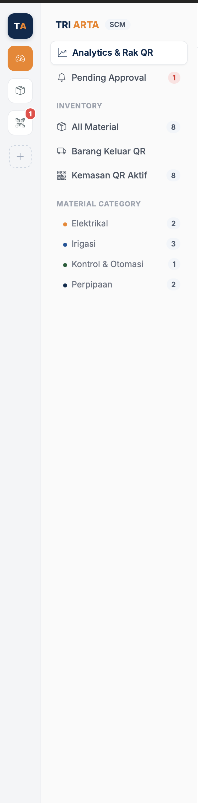

# Konteks Proyek: Sistem SCM & QR Inventory — PT Tri Arta Konstruksi

## 1. Tech Stack & Database
- **Backend:** PHP 8+ Native dengan koneksi **PDO** (`config/db.php`, tidak boleh diubah/dihapus).
- **Database:** PostgreSQL lokal (`db_scm_tri_arta`), skema 3NF ada di `database/database/db_scm_tri_arta.sql`.
- **Relasi Penting:** Tabel `staf` memakai foreign key `id_jabatan` yang berelasi ke `jabatan(id_jabatan, nama_jabatan, role_akses)` serta memiliki kolom `username VARCHAR(50) UNIQUE` dan `password_hash VARCHAR(255)` (bcrypt `PASSWORD_DEFAULT`, default pengujian `triarta123`) untuk autentikasi login berbasis `staf.username`. Tabel `material` memiliki kolom `gambar VARCHAR(255)` untuk menyimpan path foto material (`assets/uploads/material/`, ekstensi `jpg/jpeg/png/webp`, maks. 5 MB) serta auto-generate `id_material` berformat `MAT-XXX` di backend. Modul CRM menggunakan tabel `leads` (`id_lead SERIAL PRIMARY KEY`, `nama_klien`, `sumber_informasi`, `tahapan_pipeline`, `alasan_loss`, `tanggal_masuk`, `id_staf_pic VARCHAR(10) REFERENCES staf(id_staf)`). Tabel utama meliputi: `material`, `kemasan_qr`, `barang_keluar`, `detail_keluar`, `proyek`, `staf`, `jabatan`, `vendor`, `barang_masuk`, `detail_masuk`, dan `leads`.
- **Frontend:** Bootstrap 5.3.3 + Bootstrap Icons + Google Font `Inter` + Custom CSS di `layout/header.php`.

## 2. Identitas Visual & Color Palette (Wajib Dipertahankan)
- **Layout:** Clean SaaS Inventory Dashboard (2-tier collapsible left sidebar: `icon-rail` sticky always-visible dengan tombol Garis 3 / Hamburger toggle, modul cepat, avatar inisial user & logout cepat + `nav-sidebar` lebar `255px` collapsible default tertutup tersimpan di `localStorage` `ta_nav_sidebar_open_v2` = `false` dengan logo transparan besar `max-width: 215px`, tombol tunggal `Executive Summary`, dan 3 grup accordion berikon segitiga rotasi `CRM & SALES`, `INVENTORY & SCM`, `MATERIAL CATEGORY` tersimpan di `ta_nav_accordion_state_v1`, serta tampil sebagai drawer overlay + backdrop di mobile/tablet, `saas-topbar`, 5-column `stat-box-card`, `dribbble-list` table dengan SVG semi-circle arc gauge persentase, `saas-switch`, dan pagination).
- **Tipografi Global:** Skala teks besar & mudah dibaca berbasis font `Inter`: `body` `15px`, menu sidebar `14.5px` (`font-weight: 500`), header accordion `12.5px` (`font-weight: 700`), judul halaman `.saas-title` `1.65rem`, label card/tabel `14px`, dan badge `12.5px`.
- **Palet Warna Resmi & Tema Gradasi Lembut PT Tri Arta Konstruksi:**
  - Deep Navy: `#062A4E` (`--ta-navy`) & Slate teks: `#475569` (`--text-muted`)
  - Royal Blue: `#0D559B` (`--ta-blue`)
  - Construct Orange: `#F38218` (`--ta-orange`)
  - Forest Green: `#135E38` (`--ta-green`)
  - **Canvas Gradasi 3 Warna (`--bg-canvas`):** `linear-gradient(135deg, #C8DCF0 0%, #DCE8F6 52%, #F6DFC8 100%) fixed` diterapkan pada `html`, `body`, `.content-area`, dan `.main-content` (tanpa blok putih polos).
  - **Card / Form / Modal Frosted Glass:** `linear-gradient(145deg, rgba(240, 246, 253, 0.92) 0%, rgba(253, 245, 237, 0.92) 100%)` dengan `backdrop-filter: blur(8px)`, border `1px solid rgba(13, 85, 155, 0.16)`, dan `box-shadow: 0 6px 20px rgba(6, 42, 78, 0.06)`.
  - **Sidebar & Topbar/Footer Gradasi:** `.icon-rail` dan `.nav-sidebar` memakai `linear-gradient(180deg, #DFEAF6 0%, #ECF2FA 100%)` dengan border `#B8CCE0`; `.saas-topbar` dan `footer` memakai `linear-gradient(90deg, #E1ECF8 0%, #FAF0E6 100%)`.

## 3. Struktur Folder & Status File
- `config/db.php` — Koneksi PDO aktif (di-ignore Git).
- `config/auth.php` — Helper autentikasi & session PHP (`isLoggedIn()`, `getAuthUser()`, `setAuthSession()`, `requireAuth()`, `clearAuthSession()`).
- `login.php` & `logout.php` — Halaman login minimalis (Single Centered Card dengan logo transparan `assets/logo-tri-arta.png`) berbasis `staf.username` (`staf JOIN jabatan`) dan endpoint logout penghancur session.
- `layout/header.php` & `layout/footer.php` — Kerangka global UI, CSS variables tema gradasi Tri Arta, sidebar kiri 2-tier (`.icon-rail` selalu tampil sticky lebar `--rail-width: 82px` dengan tombol ikon `46×46px` `border-radius: 13px`: Hamburger toggle `bi-list`, Logo `TA` → `index.php`, Speedometer Oranye → `leads/analytics.php` aktif untuk seluruh modul `leads/`, Box → `barang/index.php`, QR Code + badge pending → `transaksi_qr/index.php`, Plus `+` quick-add dropdown, serta avatar inisial & tombol Logout cepat di bagian bawah; `.nav-sidebar` default collapsed tersimpan di `localStorage` `ta_nav_sidebar_open_v2` = `false` dan menjadi drawer overlay `left: var(--rail-width)` + backdrop `#navSidebarBackdrop` pada layar `< 992px`).
- `index.php` — Dashboard **Executive Summary** berbasis analitik **Chart.js** (KPI 5 kolom + grid 2x2 grafik: Doughnut Kesehatan Stok Material, Horizontal Bar Distribusi Kategori Material, Vertical Bar Sales Pipeline & Leads, Pie Win/Loss Ratio + widget CTA Top 5 Prioritas Restock; terproteksi `requireAuth()`).
- `leads/` — Modul CRM Leads (`analytics.php` rangkuman & analitik CRM enterprise dengan 4 kartu KPI + 5 grafik Chart.js: Sales Funnel Conversion, Channel Effectiveness, Tren Bulanan Multi-Line, Performa PIC Stacked Bar, & Loss Reasons; `index.php` pipeline & filter tahapan + quick update; `create.php` registrasi prospek baru; semuanya terproteksi `requireAuth()`).
- `barang/` — Modul CRUD Material (`index.php` dengan thumbnail foto material & modal generate/print QR `qrPrintModal`, `create.php` full-width 2 kolom dengan auto-ID `MAT-XXX` readonly & upload foto live preview, `edit.php` full-width 2 kolom dengan preview foto eksisting/baru, `delete.php`; semuanya terproteksi `requireAuth()`).
- `transaksi_qr/` — Modul QR Scanner & Pengeluaran Barang (`index.php` menggunakan custom engine `Html5Qrcode` tanpa widget putus-putus bawaan: 2 kartu atas sejajar simetris dengan `.qr-center-stage` di kartu kiri berisi ikon QR `54×54px` dan 2 tombol vertikal identik `max-width: 310px` — **Scan Kamera QR** membuka modal live camera `#cameraScannerModal` dengan `#qr-reader-popup`, pemilih kamera, & auto-`.stop()` saat ditutup, serta **Scan dari File Gambar** via `#qr-input-file` + `scanFile(file, true)`; keduanya langsung membuka pop-up detail premium `#scanResultModal` berfoto asli material, serta tabel approval mengikuti `$_SESSION['id_staf']`; `create.php` input barang keluar QR full-width; terproteksi `requireAuth()`).
- `assets/uploads/material/` — Direktori penyimpanan file foto material yang diunggah (format `jpg`, `jpeg`, `png`, `webp`).

## 4. Aturan Coding di Proyek Ini
- Setiap file di dalam subfolder (`leads/`, `barang/`, `transaksi_qr/`) wajib memanggil autentikasi, koneksi, dan layout menggunakan `__DIR__ . '/../config/auth.php'`, `__DIR__ . '/../config/db.php'`, dan `__DIR__ . '/../layout/header.php'`.
- Semua halaman aplikasi selain `login.php` dan `logout.php` wajib memanggil `requireAuth()` di bagian paling atas sebelum query/output. Data session user tersimpan pada `$_SESSION['id_staf']`, `$_SESSION['username']`, `$_SESSION['nama']`, `$_SESSION['email']`, `$_SESSION['id_jabatan']`, `$_SESSION['nama_jabatan']`, dan `$_SESSION['role_akses']`.
- Jangan merusak class CSS global yang sudah ada di `layout/header.php` (`saas-topbar`, `dribbble-list`, `dribbble-table`, `btn-toolbar-primary`, `btn-toolbar-orange`, `badge-pill-soft`).
